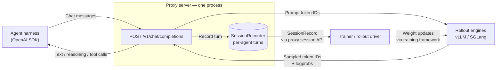
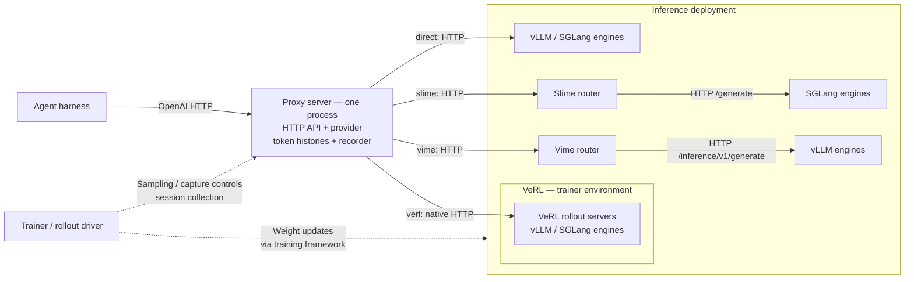

# RL Rollout Proxy Server

The RL Rollout Proxy Server (RPS) sits between agents and the RL rollout inference engine. Agents talk ordinary `chat/completions`; RPS transparently captures, per session (i.e. one rollout trial), the exact **prompt token IDs, completion token IDs, and logprobs** of every turn — the data an RL trainer needs. RPS enforces **strict token-in-token-out (TITO)** so that recorded tokens are byte-identical to what the policy actually consumed and sampled.

> **Core design** — from the agent's perspective there is nothing proxy-specific except the composed API key.

## Role in RL training

Agentic RL trains a policy on multi-turn rollouts produced by an agent harness that only speaks the OpenAI text API. Training, however, needs token-level data, and **re-tokenizing conversation text does not reliably reproduce the tokens the model actually sampled** (token-merge drift at boundaries, chat templates stripping `<think>` blocks, tool calls re-serialized from parsed JSON, etc.). RPS solves this by being the single point through which all agent LLM calls flow:



Each rollout is one **session**, which runs one or more **agents**. The session id and agent id are embedded in the API key the agent is given (**keyed routing**):

```python
client = OpenAI(
    base_url = f"{proxy_url}/v1",
    api_key  = f"{REAL_API_KEY}{DELIMITER}{session_id}{DELIMITER}{agent_id}",   # e.g. "sk-xxx-trial_042-agent_001"
)
```

The proxy authenticates the `REAL_API_KEY` part, extracts the session id and agent id, and opens the session lazily on the first request.

### Multi-agent rollouts

A rollout may spawn **several agents**; each is provisioned with a key naming its own agent id:

```python
api_key = f"{REAL_API_KEY}{DELIMITER}{session_id}{DELIMITER}{agent_id}"   # e.g. "sk-xxx-trial_042-planner"
```

Each `(session_id, agent_id)` pair owns an **independent strict-TITO token stream** — its own conversation, model pin, turn serialization, and sticky endpoint binding — so a rollout's agents converse and generate concurrently without touching each other's streams. Internally, the inference side keys everything on `{session_id}-{agent_id}`, using a fixed `-` separator regardless of the configured API-key delimiter. The rollout stays the unit of recording and lifecycle: all agents' turns land in the one `SessionRecord`, in recorder append order (which can differ from HTTP request arrival order) and tagged with their `agent_id`, and the session endpoints below fetch, complete, and delete the whole rollout — `DELETE` releases every agent's stream.

After the rollout, the driver collects the record:

| Endpoint                       | Purpose                                                  |
| ------------------------------ | -------------------------------------------------------- |
| `POST /v1/chat/completions`    | Agent-facing OpenAI endpoint (keyed routing)             |
| `GET /sessions/{id}`           | Fetch the `SessionRecord` (all turns)                    |
| `POST /sessions/{id}/complete` | Mark the rollout finished                                |
| `DELETE /sessions/{id}`        | Free the record and every agent stream's inference state |
| `GET /health`                  | Process liveness, reports `{"status":"ok"}`              |

Each turn in a `SessionRecord` contains `agent_id`, `request_messages`, `prompt_token_ids`, `new_conversation`, `completion_text`, `completion_token_ids`, `completion_logprobs`, `finish_reason`, `weight_version`, and parsed `content`, `reasoning_content`, and `tool_calls`.

Optional `rollout_top_p_token_ids` and `rollout_top_p_token_offsets` store flattened nucleus support and offsets for each completion token. Vime populates them when `top_p < 1`. Session API responses always include captured values. Disk snapshots omit these lists unless `save_rollout_sampling_masks: true`; absent values are null in memory and omitted from disk.

`weight_version` is the policy version the engine reported for that turn. A trainer that updates weights between rollout steps needs it to prove a rollout was on-policy: a session whose turns carry more than one version straddled a weight update, and the samples it yields silently mix two policies. It is `null` when the backend reports none (vLLM's OpenAI API), and a re-served lost-response retry reports the version its tokens were *sampled* under rather than the current one. Each turn records a single weight version. Drain generations before updating weights; changes within one completion cannot be represented by this record format.

`request_messages` and `prompt_token_ids` store only the turn's **delta** — the messages / prompt tokens the request appended beyond the agent's previous turn — never the full history, which would grow the record (in memory and on disk) quadratically with the conversation. The assistant echo that opens a continuation's delta is not stored either: it is reconstructed from the previous turn's parsed `content`, `reasoning_content`, and `tool_calls`, so a continuation's `request_messages` hold only the new non-assistant messages.

## Persisted session records

When `save_rollout_sessions` is enabled (the default), the proxy attempts to write each `SessionRecord` as JSON after **every turn**, without requiring `/sessions/{id}/complete`. The default path is `proxyserver/sessions/{yyyy}-{mm}-{dd}-{hh}-{MM}-{ss}/{session_id}.json`, using a directory stamped with the server start time. The file uses the same record schema as `GET /sessions/{id}`.

## Strict token-in-token-out (TITO)

The inference side keeps, per stream (one per agent of a session — see multi-agent rollouts above), the **authoritative token stream** — the exact prompt tokens fed to the engine plus the exact completion tokens it sampled — and builds every follow-up prompt as

```
prompt_{N+1} = prompt_N + completion_ids_N + gap + delta(new user/tool messages)
```

where `delta` tokenizes *only the new messages*, never the history. The assistant text echoed back by the agent is ignored for tokenization; the cached sampled tokens are authoritative. Any request that cannot be built as a strict extension of the session's stream — edited history, unexpected roles — is **rejected with an error**, never silently re-tokenized: a failed rollout is recoverable, a corrupted one is not.

`gap` appends any missing assistant-message ending declared by the model profile, preserving chat-template boundaries after natural stops and truncated completions. Gap tokens are included in the turn's recorded `prompt_token_ids`, so the reconstruction formula above is unchanged. See [Assistant turn boundaries](proxyserver/tokenization/README.md#assistant-turn-boundaries) for model-specific examples.

After exact retries are handled, a request carrying **no assistant message at all** can open a **new conversation** on the session: its full render starts a fresh stream, replacing the cached one. One exception is an assistant-free request that strictly extends the previous opening request; it is rejected as a continuation missing its assistant echo, because resetting would discard the sampled turn it is answering. Other fresh conversations contain no sampled assistant history to re-tokenize. Agents that run several sequential conversations under one session id are served this way; each conversation's turns land in the same `SessionRecord`.

Requests whose normalized messages match the previous request on the same agent stream replay the cached completion, including opening requests. To intentionally sample the same prompt again, use a new session. See [Timeouts, retries, and cleanup](#timeouts-retries-and-cleanup) for matching rules, cache retention, and replay limits.

## Serving architecture

RPS runs its inference provider in the same process as the HTTP server. The engines can run on remote GPU machines. The provider owns tokenization, per-agent token histories, inference calls, and tool parsing; the server owns session recording and OpenAI response formatting.

The provider caches a complete parsed result with each committed turn: content, reasoning, stable tool-call IDs, and finish reason. Recording, HTTP responses, and retries consume this result without parsing the completion again. Harmony extracts content, reasoning, and calls in one pass over structural token IDs.



There are four transport modes, all using the same in-process provider pipeline:

| Transport | Provider                                        | Backend                                                                | Required target             |
| --------- | ----------------------------------------------- | ---------------------------------------------------------------------- | --------------------------- |
| `slime`   | `SGLangRolloutProvider`                         | SGLang `/generate` through Slime's router                              | `router_url`                |
| `vime`    | `VLLMRolloutProvider`                           | vLLM `/inference/v1/generate` through Vime's router                    | `router_url`                |
| `verl`    | `SGLangRolloutProvider` / `VLLMRolloutProvider` | VeRL-owned SGLang or vLLM HTTP servers, selected by `inference_engine` | `router_url`                |
| `direct`  | `DirectRolloutProvider`                         | vLLM `/v1/completions` or SGLang `/generate`                           | `inference_engine_base_url` |

Direct transport assigns each agent stream to an endpoint round-robin and keeps that binding until deletion. Slime and Vime delegate placement to their routers. Slime sends the stream ID in `X-SMG-Routing-Key` for `consistent_hashing`; Vime uses `x-session-id` for `consistent_hash`. Both support per-agent prefix-cache affinity. Point each router transport at the policy model matching the agent's requested tokenizer profile.

Before sending token IDs, direct transport checks each endpoint's model against the requested tokenizer profile. vLLM supplies its model ID through `/v1/models`; SGLang supplies `served_model_name` through `/get_model_info`, falling back to `model_path` when the alias is absent. Names, full checkpoint paths, or checkpoint basenames must be registered in `tokenization/mapping.json`. Unknown or incompatible models are rejected before generation. Discovery is cached per endpoint for the provider's lifetime; failed discovery is retried.

With the HTTP transports, both engines receive token-ID prompts. Direct vLLM returns sampled IDs through `return_tokens_as_token_ids`; Vime returns `choices[0].token_ids` and aligned `logprobs.content`; SGLang returns `output_ids`, with the logprob triples as a fallback when that field is absent. The proxy decodes the sampled IDs using its bundled tokenizer. Both engines' native `stop`, `length`, and `abort` reasons are authoritative, including a natural stop on the final permitted token.

## Installation and startup

```bash
python -m pip install -r requirements.txt
export PROXY_API_KEY='<shared-key>'
```

Target values can also be supplied in YAML. **Startup requires the selected transport's target**: a missing router URL, missing/blank direct engine URLs fail before the server starts. `GET /health` reports `{"status":"ok"}` for every transport; it checks process liveness, not engine readiness.

### Slime

Start Slime's SGLang engines and router on the GPU cluster, then point the proxy at the router:

```bash
INFERENCE_ENGINE=sglang python -m proxyserver.cli \
  --transport-mode slime \
  --router-url http://<router-host>:32005 \
  --context-length 262144 \
  --no-return-routed-experts
```

The bundled Slime config enables routing capture. This example disables it; omit `--no-return-routed-experts` when the engines have `enable_return_routed_experts` enabled and the trainer needs routing replay data.

Set `--context-length` to match the engines' context window; the router cannot report it. See [Routing replay capture](#routing-replay-capture) for capture requirements and runtime controls.

### Vime

Start Vime's vLLM engines and router on the GPU cluster, then point the proxy at the router:

```bash
INFERENCE_ENGINE=vllm python -m proxyserver.cli \
  --transport-mode vime \
  --router-url http://<router-host>:30000 \
  --context-length 32768 \
  --no-return-routed-experts
```

The bundled Vime config disables routing capture. Use `--return-routed-experts` when the engines have Vime's routing replay enabled and the trainer needs the capture.

Set `--context-length` to match the engines' `--vllm-max-model-len`. The endpoint must support Vime's `/inference/v1/generate` protocol. See [Routing replay capture](#routing-replay-capture) for capture requirements and runtime controls.

### VeRL

Set `transport_mode: verl`, choose `inference_engine: sglang` or `vllm`, and point `router_url` at the corresponding VeRL rollout server. VeRL manages the inference engines and their lifecycle.

| VeRL engine | Proxy transport | Native endpoint          |
| ----------- | --------------- | ------------------------ |
| SGLang      | `verl`          | `/generate`              |
| vLLM        | `verl`          | `/inference/v1/generate` |

Get the HTTP addresses from the trainer's `LLMServerManager.get_addresses()`; these are `host:port` values, so prepend `http://`. The proxy takes a server root URL, not a `/v1` URL. For one SGLang rollout server:

```bash
INFERENCE_ENGINE=sglang python -m proxyserver.cli \
  --transport-mode verl \
  --router-url http://<verl-server-host>:<port> \
  --context-length 32768 \
  --no-return-routed-experts
```

For vLLM, use `INFERENCE_ENGINE=vllm --transport-mode verl` with the same URL and context arguments. Set the context length to the actual engine window. For a pool of replicas, set `router_url` to the deployment's HTTP router. Session affinity requires a router that supports the engine provider's affinity header.

When `top_p < 1`, launch vLLM with `return_sampling_mask=True` through VeRL's `actor_rollout_ref.rollout.engine_kwargs.vllm` settings. This is an **engine startup option**, not a generation sampling parameter. The proxy requires an aligned mask for each sampled token. If masks are not enabled, pin the proxy's `sampling_overrides.top_p` and the trainer's policy to `1.0`. Routing replay is optional and requires compatible engine output; leave capture disabled unless the trainer has enabled and verified it.

The training deployment coordinates request admission, draining, weight updates, and replica availability. Weight versions are `null` unless the server response supplies `weight_version`. Automatic LoRA selection, fully asynchronous partial rollout recovery, and disaggregated-serving orchestration are not supported by this transport.

### Direct

For direct vLLM access:

```bash
python -m proxyserver.cli \
  --transport-mode direct \
  --inference-engine-base-url http://<engine-host>:8000/v1 \
  --inference-engine-api-key '<engine-key>'
```

Set `INFERENCE_ENGINE=sglang` for direct SGLang access. Multiple engine URLs are supported; supply one API key per URL or one shared key. All endpoints must serve the model family selected by the request. For direct vLLM, the proxy discovers the served model ID through `/v1/models` and rejects unknown or incompatible profiles before generation. The served ID (or its checkpoint-path basename) must resolve through `proxyserver/tokenization/mapping.json` to the same profile as the request.

## Configuration

The available files are `proxyserver/configs/sglang-slime.yaml`, `vllm-vime.yaml`, `sglang-direct.yaml`, `vllm-direct.yaml`, `sglang-verl.yaml`, and `vllm-verl.yaml`. Although Slime is our default deployment, the CLI's fallback values are `vllm` and `direct`. Selection uses `$INFERENCE_ENGINE` and `$TRANSPORT_MODE`, with `--transport-mode` overriding the latter. Use `--config PATH` to select a file explicitly. Explicit CLI values override its corresponding settings. Target placeholders must be replaced or overridden.

A Slime configuration:

```yaml
inference_engine: sglang
transport_mode: slime
proxy_api_delimiter: "-"
host: 0.0.0.0
port: 9400
router_url: http://<router-host>:32005
router_api_key: null
context_length: 262144
rollout_session_dir: sessions
log_dir: logs
save_rollout_sessions: true
save_rollout_logprobs: true
save_rollout_sampling_masks: false
return_routed_experts: false
save_rollout_routed_experts: false
```

Relative storage directories are resolved under `proxyserver/`. Session snapshots and error logs use `{server-start-timestamp}/` subdirectories. Each error file is named `{session_id}.log`, with agent IDs on its lines. `save_rollout_logprobs: false` omits logprobs from disk only. Routed experts and sampling masks are omitted by default; enable `save_rollout_routed_experts` or `save_rollout_sampling_masks` to persist them. These settings apply to every transport and leave in-memory records and session API responses unchanged.

For Vime, change the example to `inference_engine: vllm` and `transport_mode: vime`, then supply Vime's router URL and engine window. The routing-capture controls and persistence settings have the same meaning.

To adapt the Slime example for Direct, remove `router_url`, `router_api_key`, `context_length`, and `return_routed_experts`, then apply the settings below. Set `inference_engine` to `vllm` or `sglang` to match the backend.

For Direct:

```yaml
inference_engine: vllm
transport_mode: direct
inference_engine_base_url: ["http://<engine-host>:8000/v1"]
inference_engine_api_key: ["<engine-key>"]
```

For VeRL, set `transport_mode: verl`, choose `inference_engine: sglang` or `vllm`, and set `router_url` to the VeRL rollout server. The bundled `sglang-verl.yaml` and `vllm-verl.yaml` templates disable routing capture by default.

Direct transport discovers context limits from vLLM's `/v1/models` (`max_model_len`) or SGLang's `/get_server_info` (`context_length`, falling back to `max_req_input_len`). For Slime's router and Vime, configure `context_length` to match the engines. Without it the proxy warns and leaves context clamping disabled. With a known window, the provider clamps each request's completion budget to the remaining context; a prompt already filling the window is rejected.

### Sampling and tokenizer identity

Sampling precedence is:

```text
runtime overrides > config sampling_overrides > request > bundled generation_config.json > engine defaults
```

Override layers accept `temperature`, `top_p`, `top_k`, `min_p`, `repetition_penalty`, `presence_penalty`, and `frequency_penalty`. Token limits and additional stop conditions stay request-owned. The removed `sampling_defaults` config field is rejected to avoid silently changing policy behavior.

Set sampling overrides to match the trainer's rollout distribution. Vime requires sampling masks when `top_p < 1` and rejects missing or invalid support data; enable `return_sampling_mask` at engine startup. Request-owned `seed` and `stop_token_ids` are forwarded through every transport. SGLang HTTP requests use the native `sampling_seed` field for `seed`.

| Endpoint                               | Purpose                                                                                           |
| -------------------------------------- | ------------------------------------------------------------------------------------------------- |
| `GET /sampling_overrides`              | Read `{config, runtime, effective}` policy layers                                                 |
| `PUT /sampling_overrides`              | Replace the runtime layer; `{}` clears it                                                         |
| `GET /tokenizer_fingerprint?model=...` | Read tokenizer identity and serving-template pins                                                 |
| `GET /routed_experts`                  | Read Slime/Vime/VeRL capture settings                                                             |
| `PUT /routed_experts`                  | Set capture with `{"enabled": true}` or `{"enabled": false}`; `{"enabled": null}` restores config |

The PUT endpoints require `Authorization: Bearer <PROXY_API_KEY>` using the bare configured key. These GET endpoints are open. Routing capture endpoints return 501 with the direct transport. With VeRL, enable capture only when its HTTP server supplies the required replay payload. Custom embedded handlers without the corresponding callbacks also return 501 for unsupported controls.

`tokenization/mapping.json` maps each accepted model name to a profile. Profiles declare the bundled tokenizer, generation header, assistant ending, reasoning parser, and tool-call parser. A stream is pinned to its initial model; a model switch is a 400. Unknown model names return 404. See [tokenization/README.md](proxyserver/tokenization/README.md) for the token format and bundled assets. Verify tokenizer fingerprints and pin the serving template before training.

### Routing replay capture

The Slime, Vime, and VeRL transports can capture expert selections for Rollout Routing Replay (R3). Enable `return_routed_experts` or `--return-routed-experts` on the proxy and configure the inference engines to return routing data. The proxy validates and records these selections; the training integration consumes them to replay routing during actor updates. Direct transport does not expose routing capture.

| Transport / engine | Expected engine capture format             | Continuation offset                           |
| ------------------ | ------------------------------------------ | --------------------------------------------- |
| Slime / SGLang     | Base64 int32 array                         | `routed_experts_start_len`                    |
| Vime / vLLM        | Base64 NumPy array, decoded without pickle | `sampling_params.routed_experts_prompt_start` |
| VeRL / SGLang      | Same as Slime / SGLang                     | `routed_experts_start_len`                    |
| VeRL / vLLM        | Same as Vime / vLLM                        | `sampling_params.routed_experts_prompt_start` |

For Slime and Vime, launch the engines with the framework's `--use-rollout-routing-replay` support. Slime enables SGLang's `enable_return_routed_experts`; Vime requires its vLLM routing-replay support.

For VeRL, the proxy reuses the corresponding SGLang or vLLM provider against the VeRL-owned native HTTP server. Both bundled VeRL configs disable capture by default. Enable it with:

```yaml
transport_mode: verl
inference_engine: sglang  # or vllm
router_url: http://<verl-server-host>:<port>
return_routed_experts: true
save_rollout_routed_experts: true  # Optional: include captures in disk snapshots.
```

Enable R3 in the VeRL training deployment as well. For its Megatron engine:

```bash
actor_rollout_ref.actor.megatron.router_replay.mode=R3 \
actor_rollout_ref.rollout.enable_rollout_routing_replay=True
```

Follow [VeRL's routing-replay documentation](https://github.com/verl-project/verl/blob/main/examples/router_replay/README.md) for engine-version requirements. The HTTP server must return the capture format above; enabling the proxy flag alone does not enable engine capture. A missing or malformed engine capture fails the turn before commit.

## Timeouts, retries, and cleanup

The provider's HTTP timeout defaults to 900 seconds. Configure agent-side timeouts for your expected turn length; SSE formatting does not shorten generation time.

- A client timeout or handler cancellation leaves the shielded generation-and-recording pipeline running. Its completion is recorded, and a retry with matching normalized messages receives the cached result, subject to cache retention and the replay cap.
- Replay matching treats equivalent plain text and multipart text as equal. It excludes top-level `tools` and sampling parameters, so changing those fields alone still returns the cached turn. The stream's model pin is checked first.
- Per-stream locks serialize requests through generation, parsing, and recording, including retries racing a still-running original. Retries reuse the cached parsed response, preserving tool-call IDs. Different agents can generate concurrently.
- Failures before commit leave the token stream intact. Every transport requires nonnegative integer token IDs and one finite numeric logprob per token; invalid engine results are rejected before decoding, caching, or recording and can be retried. After two deterministic upstream 4xx rejections of matching normalized messages, further matching requests fail fast using the stored error. This rejection match also excludes top-level tools and sampling parameters, so changing those fields alone does not bypass a cached rejection.
- Parsing or recording failures after commit return 500 and block session collection, so a record missing sampled tokens cannot be used for training. An exact retry reuses the committed completion and repairs the record before that agent advances; successful turns from other agents do not clear the failure.
- `DELETE /sessions/{id}` tombstones the session, rejects straggler completions with 410, cancels active and queued work, waits for cleanup, and releases every agent's provider state. Concurrent deletions share cleanup, which survives caller cancellation. Tombstones last up to one hour; above 8,192 retained entries, the oldest are evicted earlier. An ID can be reused after its tombstone expires or is evicted. Persisted session files remain.
- `POST /sessions/{id}/complete` marks the record completed; it does not release token histories. Fetch records before deletion and always delete finished sessions.

`stream: true` returns OpenAI SSE chunks **after** the entire completion is generated, validated, and recorded. It is response-format compatibility rather than incremental token delivery.

`tool_choice` supports `"auto"`, omission, or `null`. Constrained choices (`"none"`, `"required"`, or a named tool) return HTTP 400 before generation or cached replay because the token-ID transports do not enforce them.

## Tests

```bash
bash test/test_all.sh --offline  # no inference endpoints needed
bash test/test_all.sh            # also exercises configured live engines
```

See [test/README.md](test/README.md) for endpoint fixtures and coverage, and [sandbox/README.md](sandbox/README.md) for session collection and cleanup.
