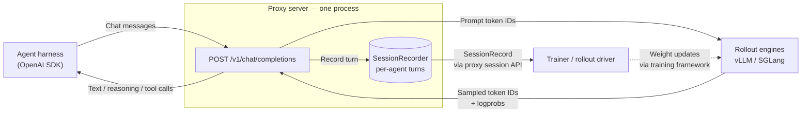
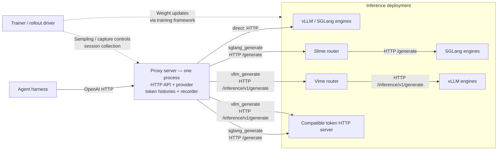

# RL Rollout Proxy Server

The RL Rollout Proxy Server (RPS) sits between agents and the RL rollout inference engine. Agents talk ordinary `chat/completions`; RPS transparently captures, per session (i.e. one rollout trial), the exact **prompt token IDs, completion token IDs, and logprobs** of every turn — the data an RL trainer needs. RPS enforces **strict token-in-token-out (TITO)** so that recorded tokens are byte-identical to what the policy actually consumed and sampled.

> **Core design** — from the agent's perspective there is nothing proxy-specific except the composed API key.

## Role in RL training

Agentic RL trains a policy on multi-turn rollouts produced by an agent harness that only speaks the OpenAI text API. Training, however, needs token-level data, and **re-tokenizing conversation text does not reliably reproduce the tokens the model actually sampled** (token-merge drift at boundaries, chat templates stripping `<think>` blocks, tool calls re-serialized from parsed JSON, etc.). RPS solves this by being the single point through which all agent LLM calls flow:



Each rollout is one **session**, which runs one or more **agents**. The session id and agent id are embedded in the API key the agent is given (**keyed routing**):

```python
DELIMITER = "|"
client = OpenAI(
    base_url = f"{proxy_url}/v1",
    api_key  = f"{REAL_API_KEY}{DELIMITER}{session_id}{DELIMITER}{agent_id}",   # e.g. "sk-xxx|trial_042|agent_001"
)
```

The proxy authenticates the `REAL_API_KEY` part, extracts the session id and agent id, and opens the session lazily on the first request.

The default API-key delimiter is `|`. Quote composed keys in shell commands because `|` is a shell operator.

### Multi-agent rollouts

A rollout may spawn **several agents**; each is provisioned with a key naming its own agent id:

```python
api_key = f"{REAL_API_KEY}{DELIMITER}{session_id}{DELIMITER}{agent_id}"   # e.g. "sk-xxx|trial_042|planner"
```

Each `(session_id, agent_id)` pair owns an **independent strict-TITO token stream** — its own conversation, model pin, turn serialization, and sticky endpoint binding — so a rollout's agents converse and generate concurrently without touching each other's streams.

After the rollout, the driver collects the record:

| Endpoint                       | Purpose                                                  |
| ------------------------------ | -------------------------------------------------------- |
| `POST /v1/chat/completions`    | Agent-facing OpenAI endpoint (keyed routing)             |
| `GET /sessions/{id}`           | Fetch the `SessionRecord` (all turns)                    |
| `POST /sessions/{id}/finalize` | Seal admission and drain accepted work through recording |
| `DELETE /sessions/{id}`        | Free the record and every agent stream's inference state |
| `GET /health`                  | Process liveness and `instance_id` (a UUID hex string)   |

For stable collection, use **finalize → GET → DELETE** after the agent has stopped issuing turns. Finalization rejects new completions with 409 and waits for accepted requests, including queued retries and detached generation/parsing/recording. Successful finalization returns `{"session_id": "...", "status": "finalized"}`.

The collector helpers in `proxyserver.client` support both synchronous and asynchronous callers. Call `finalize_session()` before `get_session()` for stable collection. `get_session()` and async `collect()` raise `httpx.HTTPStatusError` for unknown sessions instead of returning `None`. Ordinary requests default to a configurable 60-second timeout. Async `close(session_id)` only deletes, with a fixed 10-second timeout per attempt and transient retries; call `finalize()` explicitly before collection. The async client owns a reusable HTTP transport:

```python
from proxyserver.client import AsyncProxyClient

async with AsyncProxyClient(proxy_url, api_key, key_delimiter="|") as proxy:
    try:
        await proxy.finalize(session_id)
        record = await proxy.collect(
            session_id, strict=True, require_logprobs=True,
            expected_sampling=policy, expected_weight_version=weight_version,
        )
    finally:
        await proxy.close(session_id)  # session cleanup; context exit closes HTTP
```

Use one async client per event loop. `aclose()` shuts down its owned transport; an injected `http_client` remains caller-owned. `agent_key()` uses the configured server delimiter. Tokenizer fingerprinting and template-pin file work run off the event loop. Concurrent pin updates within one async client are serialized; use one client/writer per pin file across collectors.

## Persisted session records

When `save_rollout_sessions` is enabled (the default), the proxy attempts to write each `SessionRecord` as JSON after **every turn**, without requiring finalization. The default path is `.rollout-proxy-server/sessions/{yyyy}-{mm}-{dd}-{hh}-{MM}-{ss}/{session_id}.json`, using a directory stamped with the server start time.

## Strict token-in-token-out (TITO)

The inference side keeps, per stream (one per agent of a session), the **authoritative token stream** — the exact prompt tokens fed to the engine plus the exact completion tokens it sampled — and builds every follow-up prompt as

```
prompt_{N+1} = prompt_N + completion_ids_N + gap + delta(new user/tool messages)
```

where `delta` tokenizes *only the new messages*, never the history. The assistant text echoed back by the agent is ignored for tokenization; the cached sampled tokens are authoritative. A continuation that edits earlier history or supplies unexpected roles is **rejected with an error**, never silently re-tokenized.

`gap` appends any missing assistant-message ending declared by the model profile, preserving chat-template boundaries after natural stops and truncated completions. Gap tokens are included in the turn's recorded `prompt_token_ids`, so the reconstruction formula above is unchanged. See [Assistant turn boundaries](proxyserver/tokenization/README.md#assistant-turn-boundaries) for model-specific examples.

## Serving architecture

RPS runs its inference provider in the same process as the HTTP server. The engines can run on remote GPU machines. The provider owns tokenization, per-agent token histories, inference calls, and tool parsing; the server owns session recording and OpenAI response formatting.



There are three transport modes, selected by HTTP protocol and endpoint placement:

| Transport         | Provider                | Backend                                                                                              | Required target             |
| ----------------- | ----------------------- | ---------------------------------------------------------------------------------------------------- | --------------------------- |
| `sglang_generate` | `SGLangRolloutProvider` | SGLang `/generate`, directly or through a transparent router                                         | `router_url`                |
| `vllm_generate`   | `VLLMRolloutProvider`   | `/inference/v1/generate`, exposed by Vime or a compatible token HTTP server                          | `router_url`                |
| `direct`          | `DirectRolloutProvider` | vLLM `/v1/completions` or SGLang `/generate`, with model discovery and per-stream endpoint placement | `inference_engine_base_url` |

Before sending token IDs, direct transport checks each endpoint's model against the requested tokenizer profile. vLLM supplies its model ID through `/v1/models`; SGLang supplies `served_model_name` through `/get_model_info`, falling back to `model_path` when the alias is absent. Names, full checkpoint paths, or checkpoint basenames must be registered in `tokenization/mapping.json`. Unknown or incompatible models are rejected before generation.

## Installation and startup

```bash
python -m pip install .
export PROXY_API_KEY='<shared-key>'
```

Target values can also be supplied in YAML. **Startup requires the selected transport's target**: a missing router URL, missing/blank direct engine URLs fail before the server starts. `GET /health` reports `{"status":"ok","instance_id":"..."}` for every transport.

### SGLang generation

Start Slime's SGLang engines and router on the GPU cluster, then point the proxy at the router:

```bash
python -m proxyserver.cli \
  --transport-mode sglang_generate \
  --router-url http://<router-host>:32000 \
  --context-length 262144 \
  --no-return-routed-experts
```

The bundled SGLang config enables routing capture. The example explicitly disables it for an engine without routing replay. Omit `--no-return-routed-experts` when the engines have `enable_return_routed_experts` enabled and the trainer consumes routing replay data.

Set `--context-length` to match the engines' context window; the router cannot report it. See [Routing replay capture](#routing-replay-capture) for capture requirements and runtime controls.

### vLLM generation

Start Vime's vLLM engines and router on the GPU cluster, then point the proxy at the router:

```bash
python -m proxyserver.cli \
  --transport-mode vllm_generate \
  --router-url http://<router-host>:30000 \
  --context-length 32768 \
  --no-return-routed-experts
```

The bundled vLLM generation config enables routing capture. The example explicitly disables it for an engine without routing replay. Omit `--no-return-routed-experts` when the engines have Vime's routing replay enabled and the trainer consumes the capture.

Set `--context-length` to match the engines' `--vllm-max-model-len`. The endpoint must support Vime's `/inference/v1/generate` protocol. See [Routing replay capture](#routing-replay-capture) for capture requirements and runtime controls.

### Compatible token HTTP servers

External inference deployments can use `sglang_generate` for `/generate` or `vllm_generate` for `/inference/v1/generate`. Set `router_url` to the server root and `context_length` to its actual context window. The server must implement the selected transport's token-ID request and response contract, including aligned sampled log probabilities and routing capture when enabled. When collectors require policy-version validation, SGLang responses must report `meta_info.weight_version`; vLLM responses must report a top-level `weight_version` or native per-choice `weight_versions` spans. Native spans must cover every output token contiguously with one version; malformed, mixed, or conflicting versions are rejected before recording. Valid spans become the turn's recorded `weight_version`.

### Direct

For direct vLLM access:

```bash
python -m proxyserver.cli \
  --transport-mode direct \
  --inference-engine-base-url http://<engine-host>:8000/v1 \
  --inference-engine-api-key '<engine-key>'
```

Set `INFERENCE_ENGINE=sglang` for direct SGLang access. Multiple engine URLs are supported; supply one API key per URL or one shared key. All endpoints must serve the model family selected by the request. For direct vLLM, the proxy discovers the served model ID through `/v1/models` and rejects unknown or incompatible profiles before generation. The served ID (or its checkpoint-path basename) must resolve through `proxyserver/tokenization/mapping.json` to the same profile as the request.

## Configuration

The templates in `proxyserver/configs/` are `sglang-sglang_generate.yaml`, `vllm-vllm_generate.yaml`, `sglang-direct.yaml`, and `vllm-direct.yaml`. Selection uses `$TRANSPORT_MODE` (default `direct`), overridden by `--transport-mode`. If no engine is specified, generation transports infer their engine; direct defaults to `vllm`. An explicit engine or `$INFERENCE_ENGINE` takes precedence over inference and must match the selected protocol.

An SGLang generation configuration:

```yaml
inference_engine: sglang
transport_mode: sglang_generate
proxy_api_delimiter: "|"
host: 0.0.0.0
port: 9400
router_url: http://<router-host>:32000
router_api_key: null
context_length: 262144
rollout_session_dir: sessions
log_dir: logs
save_rollout_sessions: true
save_rollout_logprobs: true
return_routed_experts: false
save_rollout_routed_experts: false
```

Relative YAML storage directories are resolved under `$PROXY_DATA_DIR`, defaulting to `.rollout-proxy-server/` in the working directory. Absolute paths bypass this root. Paths expand `~` and resolve when a config/server instance is created. Explicit `LLMProxyServer(session_dir=..., error_log_dir=...)` paths resolve directly against the working directory.

Session snapshots and error logs use `{server-start-timestamp}/` subdirectories. Each error file is named `{session_id}.log`, with agent IDs on its lines.

For vLLM generation, change the example to `inference_engine: vllm` and `transport_mode: vllm_generate`, then supply the router URL and engine window. The routing-capture controls and persistence settings have the same meaning.

To adapt the SGLang generation example for Direct, remove `router_url`, `router_api_key`, `context_length`, and `return_routed_experts`, then apply the settings below. Set `inference_engine` to `vllm` or `sglang` to match the backend.

For Direct:

```yaml
inference_engine: vllm
transport_mode: direct
inference_engine_base_url: ["http://<engine-host>:8000/v1"]
inference_engine_api_key: ["<engine-key>"]
```

Both bundled generation templates set `return_routed_experts: true` and `context_length: 262144`. These are training-deployment defaults: align routing capture with the engine and trainer, and set the context window to the engine's actual limit. The minimal YAML example above explicitly overrides these defaults.

Direct transport discovers context limits from vLLM's `/v1/models` (`max_model_len`) or SGLang's `/get_server_info` (`context_length`, falling back to `max_req_input_len`). SGLang generation attempts discovery only when `context_length` is unset or explicitly `null`; routers may not expose a worker's limit. The bundled value of `262144` bypasses discovery. vLLM generation uses only the configured window. If the window remains unknown, the proxy warns and leaves context clamping disabled. Set `context_length` to the actual engine window when discovery is unavailable. With a known window, the provider clamps each request's completion budget to the remaining context.

### Sampling and tokenizer identity

Sampling precedence is:

```text
runtime overrides > config sampling_overrides > request > bundled generation_config.json > engine defaults
```

Override layers accept `temperature`, `top_p`, `top_k`, `min_p`, `repetition_penalty`, `presence_penalty`, and `frequency_penalty`. Token limits and additional stop conditions stay request-owned. The removed `sampling_defaults` config field is rejected to avoid silently changing policy behavior.

After resolving precedence, all transports clamp temperature to `MIN_TEMPERATURE = 0.01` (defined in `proxyserver/model_registry.py`). This includes `temperature: 0`: rollouts sample instead of selecting greedy decoding. Negative, non-finite, and non-numeric values remain invalid. If no layer supplies a temperature, the proxy explicitly sends `1.0`.

Sampling control responses retain the requested `config` and `runtime` values and report the floored `effective` overrides. Each turn's `sampling_params`, including disk snapshots and exact retries, contains the temperature actually sent. Both collector clients verify this floor during synchronization. Collection-time `expected_sampling` checks remain exact: use `0.01`, or the effective policy returned by synchronization, when requesting a lower value.

Set sampling overrides to match the trainer's rollout distribution. Pinning `top_p` alone is not enough, because bundled defaults such as Qwen's `top_k: 20` still apply. The proxy accepts truncated sampling without sampling masks and ignores any masks returned by the engine. Records contain sampled-token logprobs and effective sampling parameters. Request-owned `seed` and `stop_token_ids` are forwarded through every transport. SGLang HTTP requests use the native `sampling_seed` field for `seed`.

| Endpoint                               | Purpose                                                                                           |
| -------------------------------------- | ------------------------------------------------------------------------------------------------- |
| `GET /sampling_overrides`              | Read `{config, runtime, effective}` policy layers                                                 |
| `PUT /sampling_overrides`              | Replace the runtime layer; `{}` clears it                                                         |
| `GET /tokenizer_fingerprint?model=...` | Read tokenizer identity and serving-template pins                                                 |
| `GET /routed_experts`                  | Read generation-transport capture settings                                                        |
| `PUT /routed_experts`                  | Set capture with `{"enabled": true}` or `{"enabled": false}`; `{"enabled": null}` restores config |

`tokenization/mapping.json` maps each accepted model name to a profile.

### Routing replay capture

The generation transports can capture expert selections for Rollout Routing Replay (R3) from compatible inference engines. Enable `return_routed_experts` or `--return-routed-experts` on the proxy and configure the inference engines to return routing data. The proxy validates and records these selections; the trainer consumes them to replay routing during actor updates.

| Transport         | Expected engine capture format             | Continuation offset                           |
| ----------------- | ------------------------------------------ | --------------------------------------------- |
| `sglang_generate` | Base64 int32 array                         | `routed_experts_start_len`                    |
| `vllm_generate`   | Base64 NumPy array, decoded without pickle | `sampling_params.routed_experts_prompt_start` |

For Slime and Vime, launch the engines with the framework's `--use-rollout-routing-replay` support. Slime enables SGLang's `enable_return_routed_experts`; Vime requires its vLLM routing-replay support.

Both bundled generate-protocol templates enable capture at startup; the trainer controls its effective runtime setting. To explicitly enable it in a custom configuration for a compatible vLLM token HTTP server, use:

```yaml
transport_mode: vllm_generate
inference_engine: vllm
router_url: http://<engine-host>:30000
return_routed_experts: true
save_rollout_routed_experts: true
```

The HTTP server must return the capture format above; enabling the proxy flag alone does not enable engine capture.

## Timeouts, retries, and cleanup

The provider's HTTP timeout defaults to 900 seconds.

- A client timeout or handler cancellation leaves the shielded generation-and-recording pipeline running. Its completion is recorded, and a retry with matching normalized messages and the same effective `reasoning_effort` receives the cached result, subject to cache retention and the replay cap.
- Replay matching treats equivalent plain text and multipart text as equal. It excludes top-level `tools` and sampling parameters, so valid changes to those fields alone still return the cached turn.
- Per-stream locks serialize requests through generation, parsing, and recording, including retries racing a still-running original. Retries reuse the cached parsed response, preserving tool-call IDs. Different agents can generate concurrently.
- Failures before commit leave the token stream intact. Every transport requires nonnegative integer token IDs and one finite numeric logprob per token; invalid engine results are rejected before decoding, caching, or recording and can be retried.
- Parsing or recording failures after commit return 500 and block session collection, so a record missing sampled tokens cannot be used for training. An exact retry reuses the committed completion and repairs the record before that agent advances.
- `DELETE /sessions/{id}` tombstones the session, rejects straggler completions with 410, cancels active and queued work, waits for cleanup, and releases every agent's provider state. Concurrent deletions share cleanup, which survives caller cancellation.
- `POST /sessions/{id}/finalize` seals and drains the session before marking its record completed.

## Tests

```bash
bash test/test_all.sh --offline  # no inference endpoints needed
bash test/test_all.sh            # also exercises configured live engines
```

See [test/README.md](test/README.md) for test coverage, and [sandbox/README.md](sandbox/README.md) for the optional `proxyserver.client` helpers.
