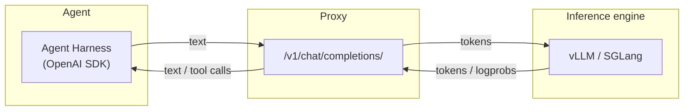

# Tokenizers, Tool-call Parsers & Model Profiles

`mapping.json` maps each served model name (provided by agents) to a **profile** — a small module in this directory that declares everything format-specific about that model family in one place:

```json
{ "Qwen3.5-9B": "qwen3_5", "Llama-3.1-8B-Instruct": "llama3_1", ... }
```

| Model names                                                                 | Profile    | Tokenizer dir    | Tool-call parser | Reasoning                  |
| --------------------------------------------------------------------------- | ---------- | ---------------- | ---------------- | -------------------------- |
| `Qwen3.5-*` (`-4B`, `-9B`, `-9B-Base`, `-27B`, `-35B-A3B`, `-35B-A3B-Base`) | `qwen3_5`  | `Qwen3.5/`       | `qwen3_coder`    | `<think>`                  |
| `Qwen3.6-27B`, `Qwen3.6-35B-A3B`                                            | `qwen3_6`  | `Qwen3.6/`       | `qwen3_coder`    | `<think>`                  |
| `Qwen3.8-27B`, `Qwen3.8-Flash-Next`                                         | `qwen3_8`  | `Qwen3.8/`       | `qwen3_coder`    | `<think>`                  |
| `GLM-5.3-Flash`                                                             | `glm5_3`   | `GLM-5.3-Flash/` | `glm47`          | `<think>`                  |
| `Llama-3.1-8B-Instruct`, `Llama-3.1-70B-Instruct`                           | `llama3_1` | `Llama-3.1/`     | `llama3_json`    | none                       |
| `gpt-oss-20b`, `gpt-oss-120b`                                               | `gpt_oss`  | `GPT-OSS/`       | `gpt_oss`        | Harmony `analysis` channel |

The model names above are registered in `mapping.json`.

A profile (`base.py` defines the contract; `qwen3_5.py` / `qwen3_6.py` / `qwen3_8.py` / `glm5_3.py` / `llama3_1.py` / `gpt_oss.py` are shipped) **states** its strict-TITO chat markers (the assistant *generation prompt* and *turn end*), its tool-call parser class, and its reasoning parser. They are **stated, not inferred** — byte-exactness of the recorded stream is too important to guess. `TokenStreamManager` measures and strips any implicit per-render prefix a template prepends. `test/test-profiles.py` compares built streams against full-template renders, including GLM's sampled continuation headers. The gpt-oss profile also declares complete action endings, required stop IDs, and a delta-message preparation hook for tool-result speakers.

**Adding a model family** is a small `<profile>.py` here plus its bundled tokenizer directory, and a `mapping.json` line pointing each model name at the profile. The reasoning parser (`base.ThinkReasoning` / `NoReasoning` / `glm5_3.GLMReasoning`) is used by the tool parser (which strips reasoning before parsing) and can re-extract a recorded completion's reasoning from its `completion_text` — so a family's reasoning format lives in exactly one place. GLM accepts either `</think>` or `<tool_call>` as the end of an open reasoning block. Harmony instead parses structural token IDs: use the recorded `reasoning_content` or `HarmonyReasoning().extract_tokens(completion_token_ids, tokenizer)`, since decoded text cannot distinguish literal marker spellings from structural tokens.

**Adding a new tool-call dialect** (a format none of `qwen3_coder` / `hermes` / `llama3_json` / `glm47` / `gpt_oss` cover) needs a parser class registered in `tool_parser.py` (in this directory) and selected by the model profile. `llama3_json` reads Llama's native `{"name": ..., "parameters": {...}}` (the whole assistant turn, no wrapper; a JSON array for parallel calls); it does not parse the `<|python_tag|>name.call(...)` builtin-tool spelling, which stays content. `glm47` reads `<tool_call>name<arg_key>key</arg_key><arg_value>value</arg_value></tool_call>`, using tool schemas to preserve string arguments and JSON decoding for other values. The bundled `Llama-3.1/chat_template.jinja` uses a **fixed** `Today Date` (not `strftime_now`), keeping renders deterministic for reproducible TITO.


## Assistant turn boundaries

`TokenStreamManager` supplies the part of the profile's `assistant_turn_end` that the sampled completion did not carry. These gap tokens precede the next message delta and are included in its recorded `prompt_token_ids`.

Qwen closes assistant messages with `<|im_end|>\n`. When generation stops at the sampled `<|im_end|>`, the gap supplies the trailing newline. Without it, the boundary would read `<|im_end|><|im_start|>user` instead of the template's `<|im_end|>\n<|im_start|>user`. After truncation at `max_tokens`, the gap supplies the whole `<|im_end|>\n` ending.

Llama closes assistant messages with `<|eot_id|>` and no trailing newline. A completion that already carries that ending needs no gap; a truncated completion receives the missing ending.

GLM uses the bare `<|assistant|>` generation header and no fixed assistant ending, letting the model sample its own `<think>` block. Opening prompts start with `[gMASK]<sop><|system|>Reasoning Effort: Low`, `High`, or `Max`, according to the selected `reasoning_effort` (default `max`). Continuation deltas are rendered with the template's default `Max` prefix, which is measured and stripped before appending them to the committed stream; the opening prompt's selected effort remains intact. A sampled `<|user|>` or `<|observation|>` stop token already opens the next message. The profile declares those `continuation_headers`, so the matching header is omitted from the new delta without removing any sampled tokens. A conflicting next role is rejected. Sampled `<|endoftext|>` is retained, and truncated turns receive the next message's header directly. Continuation headers are included in GLM's serving-template fingerprint pin.

## Why do we need a model's tokenizer and tool-call parser?

Overall, the proxy aims to guarantee TITO (token-in-token-out), as shown below:



For simplicity, the diagram omits optional HTTP routers between the proxy and the inference engine.

- The tokenizers in the proxy translate text to/from tokens.

- The tool-call parsers in the proxy translate tokens into tool calls.


## Patch

- For conversations without a genuine user query, the Qwen3.5 tokenizer throws an error `No user query found in messages`. Refer to [https://github.com/vllm-project/vllm/issues/36432](https://github.com/vllm-project/vllm/issues/36432). Hence, we patch its chat template [Qwen3.5/chat_template.jinja](Qwen3.5/chat_template.jinja).

- A render that **starts** with a `tool` message lost its `<|im_start|>user` header: the original template guards the header with `loop.previtem and loop.previtem.role != "tool"`, and `loop.previtem` is undefined on the first iteration (upstream assumes a tool message always follows an assistant one). The strict-TITO inter-turn delta renders exactly such conversations — the new tool results alone (see `proxyserver/token_stream.py`) — so every tool-turn prompt (and the recorded training stream) came out malformed: `…<tool_call>…<|im_end|>\n<tool_response>…` with no `user` block opened. Patched to `loop.first or loop.previtem.role != "tool"` in [Qwen3.5/chat_template.jinja](Qwen3.5/chat_template.jinja); full-conversation renders are byte-identical to upstream ([Qwen3.5/chat_template-upstream.jinja](Qwen3.5/chat_template-upstream.jinja) keeps the pristine original).

Qwen3.6 and Qwen3.8 use the same two delta-render patches in their respective `chat_template.jinja` files, with each upstream reference retained as `chat_template-upstream.jinja`. Qwen3.6 preserves its upstream assistant-history behavior; Qwen3.8 additionally preserves its reasoning-effort system prefix. Both profiles supply the same bare assistant header as Qwen3.5, and both bundle sampling defaults of temperature `1.0`, top-k `20`, and top-p `0.95`.

GLM-5.3's upstream template sorts parallel tool results into the preceding assistant's tool-call order. A strict-TITO delta contains only the new results, so it cannot perform that history-dependent sort. The serving template omits sorting and preserves submitted result order for both full renders and deltas. It also renders accepted `developer` instructions as native `<|system|>` messages, preserving their content and position. The default reasoning effort and retained reasoning history are preserved. Removing the disabled sorting code leaves rendered prompts unchanged but changes GLM's serving-template pin, which hashes the template source; review and update saved GLM pins when adopting this cleanup.
