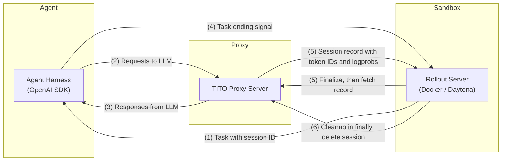

## Aligning with sandboxes

The sandbox (a Docker / Daytona container) mints a session ID and hands the agent its task. Once the agent stops issuing turns, the sandbox finalizes recording, fetches and validates the record, then consumes it.



1. The sandbox starts a rollout: it generates a fresh `session_id` and gives each agent the task plus the proxy's base URL and its own composed key `{PROXY_API_KEY}{DELIMITER}{session_id}{DELIMITER}{agent_id}` — every agent owns an independent TITO token stream, and the rollout's one record tags each turn with its `agent_id`.
2. The agent talks ordinary OpenAI `chat/completions` to the proxy; the session opens lazily on the first request.
3. The proxy records every turn's token IDs and logprobs, then returns an OpenAI chat completion with content, tool calls when present, and token counts to the agent.
4. The agent reports the task finished and stops issuing turns.
5. The sandbox finalizes the session to drain accepted work, then fetches the full `SessionRecord`, including the recorded token IDs and logprobs, from the proxy.
6. The sandbox deletes the session so the proxy frees the in-memory record and the inference side drops every agent's token stream.

## Session API used by the sandbox

| Endpoint                       | Purpose                                                                                       |
| ------------------------------ | --------------------------------------------------------------------------------------------- |
| `POST /sessions/{id}/finalize` | Seal admission and drain accepted work through recording before collection                    |
| `GET /sessions/{id}`           | Fetch the `SessionRecord` — model, per-turn token IDs / logprobs / tool calls; 404 if unknown |
| `DELETE /sessions/{id}`        | Free the in-memory record and release per-session inference state                             |

## `utils.py`

The installed package provides synchronous HTTP helpers in `proxyserver.client`. [`utils.py`](utils.py) re-exports them for existing sandbox callers; install `rollout-proxy-server` in the collector's environment to use either entry point.

```python
from proxyserver.client import finalize_session, get_session, end_session

PROXY_URL = "http://proxy-host:9400"

try:
    finalize_session(PROXY_URL, session_id)   # Seal admission and drain recording
    record = get_session(PROXY_URL, session_id)  # Step (5); raises if unknown
finally:
    end_session(PROXY_URL, session_id)        # Step (6): delete or abandon
train_on(record["turns"])                    # token IDs + logprobs per turn
```

For training, the installed package also supports optional checks during collection:

```python
record = get_session(
    PROXY_URL, session_id,
    expected_sampling={"temperature": 1.0, "top_p": 1.0},
    expected_weight_version="7",  # Omit for unversioned direct engines.
    trained_agent_ids={"planner"},
)
```

Things to know:

- **Finalize, fetch, then end.** Call `finalize_session` to drain accepted work before fetching; a GET by itself is a live snapshot. `GET /sessions/{id}` serves from the proxy's in-memory record, which `end_session` deletes. Successfully written JSON snapshots under `$PROXY_DATA_DIR/sessions/` (default `.rollout-proxy-server/sessions/`) survive deletion when persistence is enabled, but contain only the fields configured for persistence; routed-expert captures are omitted by default. Failed writes are logged, so disk snapshots are not a lossless recovery guarantee.
- **Always end sessions.** Deletion releases every agent's provider state, including its strict-TITO token stream, which grows with every turn — a sandbox that never ends sessions leaks inference-side memory across rollouts.
- **Cleanup only deletes and tolerates transient failures.** `end_session()` never marks success. Deletion retries transport errors and HTTP 408/429/500/502/503/504 up to four total attempts, waiting 0.5, 1, then 2 seconds. A deletion response of 404 is success; permanent errors and exhausted retries propagate. Cleanup uses a fixed 10-second timeout per request. Other helpers default to a configurable 60-second timeout.
- **Collection checks identity.** A successful response must contain the requested `session_id`; a mismatched or malformed record raises `ValueError` even when policy validation is disabled.
- **Turns are delta-encoded, per agent and conversation.** A turn with `new_conversation: true` stores the full opening request and prompt. Later turns store only the new messages / prompt tokens for that agent. Reconstruct separately for each `agent_id`, restarting whenever `new_conversation` is true (see [strict TITO](../README.md#strict-token-in-token-out-tito)).
- Deletion returns 200 for unknown or already-deleted sessions and creates or refreshes a tombstone, rejecting chat-completion requests with 410 while it is retained. Finalizing an unknown session returns 404; finalizing a deleted session returns 410. Fetching an unknown session returns 404, which `get_session()` raises as `httpx.HTTPStatusError`.

## Optional setup before collection

Use the bare proxy API key for control updates. Each control is optional; omitting `routed_experts` avoids calling that endpoint for direct engines.

```python
from proxyserver.client import check_tokenizer, synchronize_proxy

check_tokenizer(
    PROXY_URL,
    checkpoint="/checkpoints/my-model",
    model="Qwen3.5-9B",
    pin_file="./run-config/template-pins.json",  # Optional persistent check.
)

policy = {"temperature": 1.0, "top_p": 1.0, "top_k": -1, "min_p": 0.0,
          "repetition_penalty": 1.0, "presence_penalty": 0.0, "frequency_penalty": 0.0}
settings = synchronize_proxy(PROXY_URL, api_key=PROXY_API_KEY, sampling=policy)
# For a compatible router transport, also pass routed_experts=True or False.

# After the rollout, verify the actual recorded policy as well:
record = get_session(PROXY_URL, session_id, expected_sampling=policy)
```

`synchronize_proxy` replaces the runtime sampling layer and verifies the returned runtime and effective values. Supplied sampling keys must match, with temperature floored to `0.01` in the effective policy (including a requested zero); other configured defaults may remain. Pass all seven distribution parameters for a complete policy, or `sampling={}` to clear runtime overrides. `None` skips a control. The return value contains full endpoint responses under `sampling_overrides` and/or `routed_experts`. Updates are sequential: if the second update fails, the first may already be applied. Correct the failure and synchronize again before collecting. Use instance binding below to detect proxy replacement; collection-time policy validation still checks what was actually sampled.

`check_tokenizer` compares the fingerprint protocol, probe corpus, and token identity against the checkpoint. Checkpoint tokenizer loading is lazy and cached per path for the process. Serving templates intentionally differ from release templates, so their pins are checked separately. Without `pin_file`, no file is written. With it, the first successful check records the model's serving-template pin in a JSON mapping; subsequent changes raise `ValueError` and preserve the saved pin. Review template changes before explicitly updating that file.

## Optional restart binding

Pin one instance before setup and carry it through every helper and agent key. The same functions are available from `sandbox.utils` and `proxyserver.client`:

```python
from proxyserver.client import (
    agent_key, end_session, finalize_session, get_proxy_instance,
    get_session, synchronize_proxy,
)

instance_id = get_proxy_instance(PROXY_URL)
bound = {"expected_instance_id": instance_id}
synchronize_proxy(PROXY_URL, api_key=PROXY_API_KEY, sampling=policy, **bound)
try:
    run_agent(api_key=agent_key(PROXY_API_KEY, session_id, instance_id=instance_id))
    finalize_session(PROXY_URL, session_id, **bound)
    record = get_session(PROXY_URL, session_id, expected_sampling=policy, strict=True, **bound)
finally:
    end_session(PROXY_URL, session_id, **bound)
get_proxy_instance(PROXY_URL, **bound)  # verify the original instance before accepting the batch
```

Pass `**bound` to `check_tokenizer` as well when used. Configure `agent_key`'s `key_delimiter` to match the server (RPS defaults to `"|"`). Existing unbound helpers and three-part agent keys remain supported.
