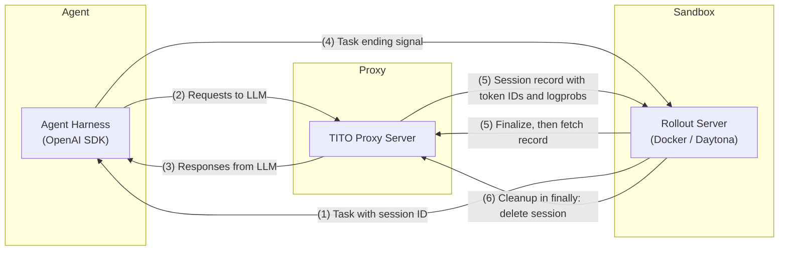

## Aligning with sandboxes

The sandbox (a Docker / Daytona container) mints a session ID and hands the agent its task. Once the agent stops issuing turns, the sandbox finalizes recording, fetches and validates the record, then consumes it.



1. The sandbox starts a rollout: it generates a fresh `session_id` and gives each agent the task plus the proxy's base URL and its own composed key `{PROXY_API_KEY}{DELIMITER}{session_id}{DELIMITER}{agent_id}` — every agent owns an independent TITO token stream, and the rollout's one record tags each turn with its `agent_id`.
2. The agent talks ordinary OpenAI `chat/completions` to the proxy; the session opens lazily on the first request.
3. The proxy records every turn's token IDs and logprobs, then returns an OpenAI chat completion with content, tool calls when present, and token counts to the agent.
4. The agent reports the task finished and stops issuing turns.
5. The sandbox finalizes the session to drain accepted work, then fetches the full `SessionRecord`, including the recorded token IDs and logprobs, from the proxy.
6. The sandbox deletes the session so the proxy frees the in-memory record and the inference side drops every agent's token stream.

## Session API used by the sandbox

| Endpoint                       | Purpose                                                                                       |
| ------------------------------ | --------------------------------------------------------------------------------------------- |
| `POST /sessions/{id}/finalize` | Seal admission and drain accepted work through recording before collection                    |
| `GET /sessions/{id}`           | Fetch the `SessionRecord` — model, per-turn token IDs / logprobs / tool calls; 404 if unknown |
| `DELETE /sessions/{id}`        | Free the in-memory record and release per-session inference state                             |

## Client helpers

The installed package provides synchronous HTTP helpers in `proxyserver.client`. Install `rollout-proxy-server` in the collector's environment and import the helpers directly from that module.

```python
from proxyserver.client import finalize_session, get_session, end_session

PROXY_URL = "http://proxy-host:9400"

try:
    finalize_session(PROXY_URL, session_id)   # Seal admission and drain recording
    record = get_session(PROXY_URL, session_id)  # Step (5); raises if unknown
finally:
    end_session(PROXY_URL, session_id)        # Step (6): delete or abandon
train_on(record["turns"])                     # token IDs + logprobs per turn
```

For training, the installed package also supports optional checks during collection:

```python
record = get_session(
    PROXY_URL, session_id,
    expected_sampling={"temperature": 1.0, "top_p": 1.0},
    expected_weight_version="7",  # Omit for unversioned direct engines.
    trained_agent_ids={"planner"},
)
```

## Timeouts, retries, and cleanup

The provider's HTTP timeout defaults to 900 seconds.

- A client timeout or handler cancellation leaves the shielded generation-and-recording pipeline running. Its completion is recorded, and a retry with matching normalized messages and the same effective `reasoning_effort` receives the cached result, subject to cache retention and the replay cap.
- Replay matching treats equivalent plain text and multipart text as equal. It excludes top-level `tools` and sampling parameters, so valid changes to those fields alone still return the cached turn.
- Per-stream locks serialize requests through generation, parsing, and recording, including retries racing a still-running original. Retries reuse the cached parsed response, preserving tool-call IDs.
- Failures before commit leave the token stream intact. Every transport requires nonnegative integer token IDs and one finite numeric logprob per token; invalid engine results are rejected before decoding, caching, or recording and can be retried.
- Parsing or recording failures after commit return 500 and block session collection, so a record missing sampled tokens cannot be used for training. An exact retry reuses the committed completion and repairs the record before that agent advances.
- `DELETE /sessions/{id}` tombstones the session, rejects straggler completions with 410, cancels active and queued work, waits for cleanup, and releases every agent's provider state.
- `POST /sessions/{id}/finalize` seals and drains the session before marking its record completed.

## Optional setup before collection

Use the bare proxy API key for control updates. Each control is optional; omitting `routed_experts` avoids calling that endpoint for direct engines.

```python
from proxyserver.client import check_tokenizer, synchronize_proxy

check_tokenizer(
    PROXY_URL,
    checkpoint="/checkpoints/my-model",
    model="Qwen3.5-9B",
    pin_file="./run-config/template-pins.json",  # Optional persistent check.
)

policy = {"temperature": 1.0, "top_p": 1.0, "top_k": -1, "min_p": 0.0,
          "repetition_penalty": 1.0, "presence_penalty": 0.0, "frequency_penalty": 0.0}
settings = synchronize_proxy(PROXY_URL, api_key=PROXY_API_KEY, sampling=policy)
# For a compatible router transport, also pass routed_experts=True or False.

# After the rollout, verify the actual recorded policy as well:
record = get_session(PROXY_URL, session_id, expected_sampling=policy)
```

`synchronize_proxy` replaces the runtime sampling layer and verifies the returned runtime and effective values. Supplied sampling keys must match, with temperature floored to `0.01` in the effective policy (including a requested zero); other configured defaults may remain. Pass all seven distribution parameters for a complete policy, or `sampling={}` to clear runtime overrides. `None` skips a control. The return value contains full endpoint responses under `sampling_overrides` and/or `routed_experts`. Updates are sequential: if the second update fails, the first may already be applied. Correct the failure and synchronize again before collecting.

`check_tokenizer` compares the fingerprint protocol, probe corpus, and token identity against the checkpoint. Checkpoint tokenizer loading is lazy and cached per path for the process. Serving templates intentionally differ from release templates, so their pins are checked separately. Without `pin_file`, no file is written. With it, the first successful check records the model's serving-template pin in a JSON mapping; subsequent changes raise `ValueError` and preserve the saved pin. Review template changes before explicitly updating that file.
